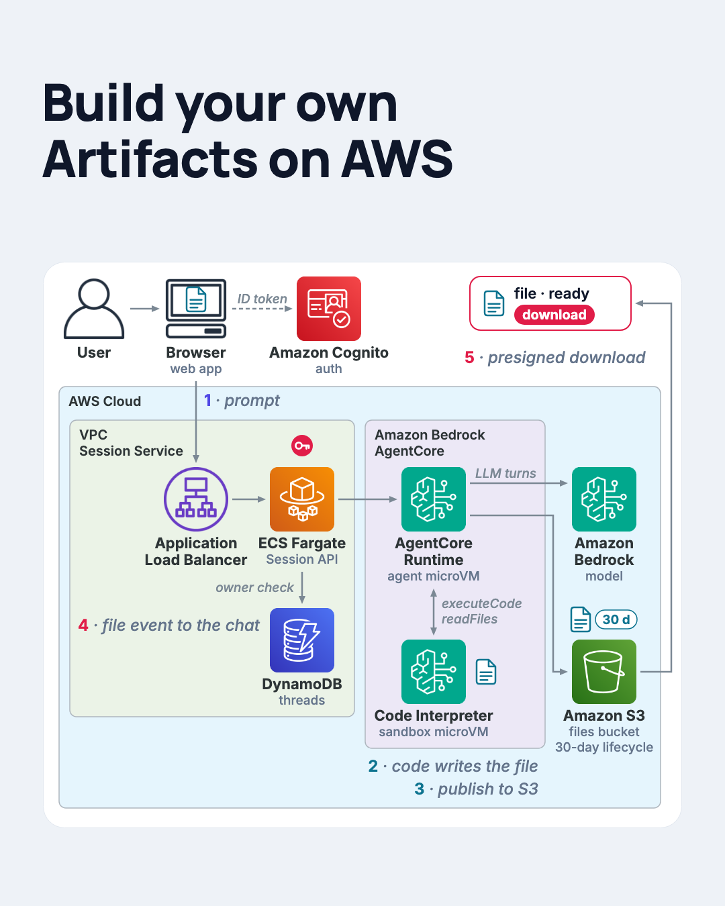

# Build your own Artifacts on AWS

A minimal, working reference for the "artifacts" pattern: an AI agent that hands the user a **file** (a
spreadsheet, a report, a chart) instead of a wall of text. The agent writes code in a sandbox, the file is
published to S3, the chat shows a download card, and the browser downloads straight from S3 with a short-lived
link. Everything is managed AWS plus one custom tool.



## What you get

| Piece | AWS resource | Folder |
|---|---|---|
| Sign-in | Amazon Cognito user pool, app client, one demo user | `infra/platform/cognito.tf` |
| Session API | Application Load Balancer, ECS Fargate (FastAPI), DynamoDB threads table | `infra/platform/api.tf`, `services/api` |
| Agent | Amazon Bedrock AgentCore Runtime hosting a Strands agent on an Amazon Nova model | `infra/platform/agent.tf`, `services/agent` |
| Sandbox | AgentCore Code Interpreter (the default `aws.codeinterpreter.v1`) | `services/agent/app/sandbox.py` |
| Files | S3 bucket with a 30-day lifecycle rule, presigned downloads | `infra/platform/storage.tf`, `services/api/app/files.py` |
| Web page | one static `index.html` served by the API | `services/api/web/index.html` |

## How it works, in five moves

1. **Prompt.** The browser signs in with Cognito (`InitiateAuth`, no hosted UI) and `POST`s the prompt to the
   Session API through the load balancer. The API verifies the ID token, checks the thread in DynamoDB and opens a
   stream back to the browser (Server-Sent Events).
2. **Agent.** The API invokes the agent on **AgentCore Runtime** (`InvokeAgentRuntime`). Every thread maps to one
   runtime session, and every session gets its own microVM, so the agent's memory lasts as long as the session.
   The agent calls its model on Amazon Bedrock.
3. **Sandbox.** When the task needs a file, the agent writes code and runs it in **AgentCore Code Interpreter**,
   a second microVM with no public internet. The file exists only there.
4. **Publish.** The agent calls `publish_file(path, title)`. The tool runs in the runtime: it reads the file out of
   the sandbox once (`readFiles`) and `PutObject`s it into the S3 bucket under
   `users/<user>/threads/<thread>/<fileId>/<name>`. A small `file` event (name, size, type, expiry) rides the
   chat stream and the page draws a download card. The bytes never enter the model's context or the chat stream.
5. **Download.** Clicking the card asks the API for the file; the API answers with a presigned S3 URL and the
   browser downloads directly from S3. Files expire with the bucket's lifecycle rule, and the API hides expired
   files before the rule has swept them.

### The stream

The API relays the agent's events unchanged. Each event is one JSON object:

| `type` | Fields | Meaning |
|---|---|---|
| `text` | `delta` | a piece of the assistant's answer |
| `tool` | `name`, `status` (`start`/`end`), `toolUseId`, `ok` | a tool call began or finished |
| `file` | `fileId`, `name`, `title`, `size`, `mimeType`, `threadId`, `runId`, `createdAt`, `expiresAt` | a file was published |
| `done` | `runId`, `stopReason` | the turn is over |
| `error` | `code`, `message` | something failed (`AGENT_ERROR`, `UPSTREAM_ERROR`, `RUNTIME_UNAVAILABLE`, ...) |

Comment lines (`: ping`) are heartbeats so the load balancer keeps the connection open while the agent thinks.

## Prerequisites

- An AWS account with **Amazon Bedrock model access** for the model you pick (default `us.amazon.nova-pro-v1:0`).
  Quick check: `aws bedrock-runtime converse --model-id us.amazon.nova-pro-v1:0 --messages '[{"role":"user","content":[{"text":"hi"}]}]'`.
- Amazon Bedrock AgentCore available in your region (us-east-1 is a safe choice).
- A default VPC in the region (`aws ec2 create-default-vpc` if you deleted it), or pass `vpc_id` and
  `public_subnet_ids`.
- Locally: AWS CLI v2 with credentials, Terraform >= 1.14, Docker with buildx (the images are `linux/arm64`,
  which AgentCore requires), Python 3.13+, `make`.

## Deploy

```bash
cd build-artifacts-aws-bedrock
export AWS_PROFILE=<your profile> AWS_REGION=us-east-1          # or keys in the environment
cp infra/platform/terraform.tfvars.example infra/platform/terraform.tfvars
$EDITOR infra/platform/terraform.tfvars                          # demo user email + password (12+ chars, mixed)

make bootstrap        # 1. two ECR repositories
make images           # 2. build + push api and agent images (prints IMAGE_TAG)
make deploy           # 3. everything else; takes a few minutes (runtime + Fargate steady state)
make smoke            # 4. sign in, ask for a CSV, download it, clean up
```

`make deploy` prints the outputs. Open `api_url` in a browser, sign in with the demo user, start a thread and ask
for something like *"Create a CSV named fruits.csv with 3 rows (name, color, price) and publish it with the title
Fruits"*. The first run on a fresh session takes up to a minute (the microVM and the sandbox start cold); the
page shows a hint until the first event arrives.

Ship a code change with `make images deploy` (a new tag creates a new runtime version and the `live` endpoint
moves to it). Run the unit tests with `make venv test`, and `make validate` checks the Terraform without
credentials.

## Costs and cleanup

The load balancer is the fixed cost (about $16 per month); Fargate at 0.5 vCPU / 1 GB is a few dollars a month;
Nova tokens and Code Interpreter seconds are pay-per-use and tiny at demo volumes. S3 and DynamoDB are cents.
Destroy when you are done:

```bash
make destroy          # platform, then ECR, then the log groups AWS created on its own (AgentCore runtime logs, Container Insights)
```

## Security notes (read before pointing anyone else at it)

- The load balancer listens on **HTTP** by default so you can deploy without owning a domain. ID tokens travel in
  clear text on that hop. For anything beyond a demo set `acm_certificate_arn` (the stack then serves HTTPS and
  redirects HTTP) and point a DNS name at the ALB.
- The files bucket never renders content: HTML, SVG, XML and JavaScript are stored as `application/octet-stream`
  and every object carries `Content-Disposition: attachment`. A user-generated artifact can't become a page served
  from your bucket.
- Presigned links live for `files_url_ttl_seconds` (default 300). File ids are random; a missing, expired or
  foreign file returns the same 404.
- The agent's S3 permission is `PutObject` under `users/*` only; the user and thread in the key come from the run
  context, never from the model.
- One Terraform variable, `files_ttl_days`, feeds the lifecycle rule and both containers, so the UI's idea of
  "expired" never drifts from the bucket's.

## Limits and gotchas

- **Sandbox sessions expire on an absolute clock.** AgentCore terminates a Code Interpreter session
  `sessionTimeoutSeconds` after it starts, idle or not. The agent drops its session 30 s before the deadline and
  starts a fresh one; files created in the old session are gone, which is why `publish_file` runs right after the
  file is written.
- **One file per `publish_file` call, read in one `readFiles` round trip.** The default cap is 15 MiB
  (`files_max_bytes`); bigger files need a different transport (for example a custom interpreter with an execution
  role writing to S3 directly).
- **No transcript persistence.** The agent's memory lives in the runtime session's microVM (idle timeout 15 min,
  max 8 h). Reloading the page restores the files of a thread, not the conversation. Adding AgentCore Memory is the
  natural next step.
- **Single Fargate task, no autoscaling, local Terraform state.** It is a reference, not a product.
- **Nova and tool use.** Nova Pro follows the publish instruction reliably with the included system prompt; if you
  see the agent describe a file without publishing it, switch `model_id` to `us.amazon.nova-premier-v1:0` or an
  Anthropic inference profile your account has access to. Nova also narrates its plan inside `<thinking>` tags when
  it uses tools; the agent strips those blocks from the stream (`ThinkingFilter` in `services/agent/app/agent.py`)
  so the user only sees the answer.

## Layout

```
infra/ecr/           two ECR repositories (bootstrap stack)
infra/platform/      Cognito, DynamoDB, S3, AgentCore runtime + IAM, ALB + ECS Fargate + IAM, outputs
services/api/        FastAPI Session API: auth, threads, runs (SSE relay), files, the web page, tests
services/agent/      the AgentCore container: Strands agent, sandbox wrapper, publish_file tool, tests
scripts/smoke.py     end-to-end check used by `make smoke`
docs/                architecture image
```

## License

MIT, see the repository [LICENSE](../LICENSE).
