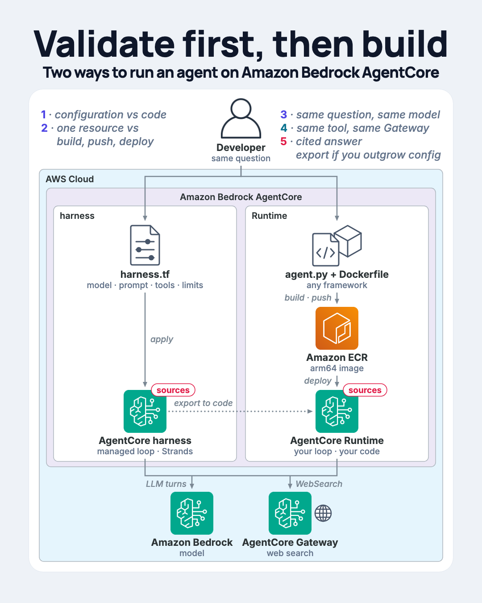

# Harness or Runtime? The same agent, two ways, on Amazon Bedrock AgentCore

Do you need a VPC, a container pipeline and weeks of setup to find out whether an agent belongs in your product?
Not any more. Amazon Bedrock AgentCore gives you two ways to run one, and this project deploys the **same** small
research agent both ways so you can feel the difference:

| | **A. AgentCore harness** | **B. AgentCore Runtime** |
|---|---|---|
| What you write | one Terraform resource: model, prompt, tools, memory, limits | your code (Strands), a Dockerfile, the same Terraform plus an image pipeline |
| Who runs the loop | AgentCore (the harness is powered by Strands Agents) | you |
| What you get for free | isolated microVM per session, filesystem and shell, short and long-term memory, tracing, versions | isolated microVM per session, sessions, tracing, versions and endpoints |
| What you can change | configuration; export to code when it is not enough | anything: framework, loop, streaming, hooks, protocols |
| Extra charge | none for the harness itself | none for the runtime itself |

Both flavors use one Amazon Bedrock model (Amazon Nova 2 Lite by default), one system prompt (`prompts/system-prompt.md`,
read by Terraform for the harness and shipped base64-encoded to the container for the runtime, because AgentCore environment variables cannot carry newlines) and one tool: AWS's managed web
search, exposed as an MCP tool by a shared **AgentCore Gateway**. Ask either flavor a question that needs fresh facts
and both search, both cite their sources, and you can read both bills.



Read first: [AgentCore harness vs. Runtime](https://docs.aws.amazon.com/bedrock-agentcore/latest/devguide/harness-vs-runtime.html),
[AgentCore harness](https://docs.aws.amazon.com/bedrock-agentcore/latest/devguide/harness.html),
[Web Search Tool connector](https://docs.aws.amazon.com/bedrock-agentcore/latest/devguide/gateway-target-connector-web-search-tool.html).

## What you get

| Piece | AWS resource | Folder |
|---|---|---|
| The tool | AgentCore Gateway (SigV4 in, MCP out) with the `web-search` connector target | `infra/platform/gateway.tf`, `gateway_iam.tf` |
| Flavor A | AgentCore harness: Nova 2 Lite, the shared prompt, the gateway as its only tool, managed memory, PoC limits | `infra/platform/harness.tf`, `harness_iam.tf` (92 lines of HCL, comments included) |
| Flavor B | AgentCore Runtime hosting a Strands agent in an arm64 container, plus a `live` endpoint | `infra/platform/runtime.tf`, `runtime_iam.tf`, `services/agent` |
| The prompt | one Markdown file, two consumers | `prompts/system-prompt.md` |
| Clients | a terminal chat for either flavor and a smoke test that asks both | `scripts/chat.py`, `scripts/smoke.py` |

## How each flavor answers a question

**Harness.** `scripts/chat.py --flavor harness` calls `InvokeHarness(harnessArn, runtimeSessionId, messages)`.
AgentCore starts (or resumes) the session's microVM, runs the Strands loop it owns with the model, prompt and tools
from `harness.tf`, calls the gateway when the model asks for `WebSearch`, and streams back its own event format:
`messageStart`, `contentBlockStart`/`contentBlockDelta`/`contentBlockStop` (text, tool use, tool result),
`messageStop` with a `stopReason`, and a final `metadata` event with token usage and latency. With managed memory on,
the conversation is also written to an AgentCore Memory the harness created for itself.

**Runtime.** `scripts/chat.py --flavor runtime` calls `InvokeAgentRuntime(agentRuntimeArn, qualifier="live",
runtimeSessionId, payload)`. AgentCore routes the call to the session's microVM running *our* container:
`app/main.py` (FastAPI, `GET /ping`, `POST /invocations`) hands the prompt to the session's Strands `Agent`
(`app/agent.py`), whose only tool is an `MCPClient` pointed at the gateway URL and signing with the container's
IAM role (`mcp-proxy-for-aws`). We decide what the stream looks like: `text`, `tool` (with the query), `done`
(with `stopReason` and usage) and `error` events as Server-Sent Events.

Same model, same prompt, same tool, same microVM isolation. The difference is who wrote the loop.

Note the tool's name: the gateway prefixes every tool with its target name, so the model sees `web-search___WebSearch`.
The harness is told to offer only that tool (`allowed_tools = ["@web_search"]`); otherwise it also gets its built-in
`shell` and `file_operations` tools, which cost about 900 input tokens per model call and would make the comparison unfair.

## Prerequisites

- An AWS account with **Amazon Bedrock model access** for the model you pick (default `us.amazon.nova-2-lite-v1:0`).
  Quick check: `aws bedrock-runtime converse --model-id us.amazon.nova-2-lite-v1:0 --messages '[{"role":"user","content":[{"text":"hi"}]}]'`.
  Anthropic models need model access and, on first use, the Marketplace subscription the IAM roles already allow.
- A region where AgentCore **and** the Web Search Tool are available: `us-east-1`, `us-east-2`, `us-west-2`,
  `eu-west-1`, `ap-southeast-2` or `ap-northeast-1` (Terraform refuses others).
- Locally: AWS CLI v2 with credentials, Terraform >= 1.14, Python 3.13+, `make`; for the Runtime flavor, Docker with
  buildx (the image is `linux/arm64`, which AgentCore requires). The clients need boto3 >= 1.43 (`InvokeHarness`);
  `make venv` installs it. The AWS CLI may not have `invoke-harness` yet, which is why the clients are Python.
- Your own identity needs `bedrock-agentcore:InvokeHarness` and `bedrock-agentcore:InvokeAgentRuntime` (an admin profile has them).

## Deploy

```bash
cd harness-vs-runtime-aws-bedrock
export AWS_PROFILE=<your profile> AWS_REGION=us-east-1          # or keys in the environment
cp infra/platform/terraform.tfvars.example infra/platform/terraform.tfvars   # optional: model, memory, region

make bootstrap        # 1. the agent's ECR repository (Runtime flavor only)
make images           # 2. build + push the agent image (prints IMAGE_TAG)
make deploy           # 3. gateway + web search, harness, runtime + endpoint, three IAM roles
make venv smoke       # 4. ask both flavors one question that needs a search; prints usage side by side
```

Then talk to either one. The same session id is kept for the whole chat, so both flavors remember earlier turns:

```bash
make chat FLAVOR=harness
make chat FLAVOR=runtime
make chat FLAVOR=harness ONCE="Which tools can you call? Name them."
```

The first turn on a fresh session takes 30 to 90 seconds on either flavor (the microVM starts cold); later turns are
seconds. Change the prompt in `prompts/system-prompt.md` and `make deploy`: the harness is updated in place (a new
version behind its default endpoint) and the runtime gets a new environment variable (a new runtime version, the
`live` endpoint moves). No image rebuild. A code change in `services/agent` is `make images deploy`.

**Harness only, no Docker:** `make deploy smoke ENABLE_RUNTIME=false`. That is the whole point of flavor A: a
`terraform apply` and you have an agent with memory, a shell, tracing and a web search tool to talk to.

Run the unit tests with `make venv test` (offline, a scripted agent stands in for the model) and `make validate` to
check the Terraform without credentials.

## What to look at

- `infra/platform/harness.tf`: the whole agent. Model, prompt, one tool, memory strategy, iteration/time/token caps,
  context truncation, session lifetime. Everything the Runtime flavor implements by hand is one argument here.
- `services/agent/app/agent.py`: the hand-written version. The MCP client with SigV4, the per-session agent, the hook
  that turns tool calls into stream events, the queue that orders them. `app/main.py` is the HTTP contract AgentCore
  expects from a container.
- `infra/platform/*_iam.tf`: three roles. The harness role carries what the managed loop needs (model, memory, the
  managed image from ECR Public, traces); the runtime role carries what *your* container needs (model, your ECR
  image, traces); the gateway role is what lets the gateway call the web-search tool for both.
- `prompts/system-prompt.md`: read by Terraform's `file()` for the harness and shipped as `SYSTEM_PROMPT_B64` to the
  container (environment variables reject newlines, so the bytes travel base64-encoded and `settings.py` decodes them). One file is what makes the comparison honest.

## Costs

There is no charge for the harness or the runtime as such; you pay for what they use. A one-hour proof of concept
with about 20 searches and 30 model calls across both flavors costs well under a dollar on Nova 2 Lite:

| Item | What is billed | Order of magnitude |
|---|---|---|
| Web search | $7 per 1,000 queries | $0.14 for 20 queries |
| Gateway | $0.005 per 1,000 tool invocations | cents |
| Runtime microVMs (both flavors) | per-second vCPU and GB while a session runs; CPU is not billed while waiting on the model or a tool | about $0.05 for two sessions over an hour |
| Model | Nova 2 Lite tokens (Bedrock price list) | cents for 30 calls with search results in context |
| Managed memory (harness) | short-term events per GB, long-term records per 1,000 per month | cents at this volume |
| CloudWatch logs, ECR image | ingestion, storage | cents |

What accrues when idle: nothing on compute once sessions hit the idle timeout (600 s) or max lifetime (3600 s).
Memory records (7-day expiry), one ECR image and the log groups keep costing cents until you destroy:

```bash
make destroy          # platform, then ECR, then the log groups AgentCore created on its own for both flavors
```

`DeleteHarness` deletes the managed memory with the harness.

## When configuration is not enough: export

The harness is configuration, so the day you need a graph instead of a loop, bidirectional streaming, a framework
that is not Strands, or a hook the harness does not offer, you export it:

```bash
agentcore export harness --arn $(terraform -chdir=infra/platform output -raw harness_arn)
```

The AgentCore CLI writes a Strands project (Python, CodeZip build type) with the model config, prompt, limits and
remote MCP tools carried over, plus an `EXPORT_NOTES.md`. Gateway tools and managed memory are **not** carried over;
you wire them back in code. `services/agent/app/agent.py` shows exactly what that wiring looks like for the gateway:
an `MCPClient` with a SigV4 transport. In other words, flavor B is where flavor A goes when it grows up, and the
service underneath (AgentCore Runtime) is the same one the harness was running on all along.

## Limits and gotchas

- **Not every model can stream a tool call against this schema.** The gateway's `WebSearch` tool has a nested input
  schema (`query`, `maxResults`, `filters` with domain and published-date filters). Amazon Nova Pro fails on it on both
  flavors, every time, with `modelStreamErrorException: Model produced invalid sequence as part of ToolUse`; Amazon
  Nova 2 Lite, Claude Haiku 4.5 and Claude Sonnet 4.6 handle it. That is why the default `model_id` is Nova 2 Lite.
  Before blaming the harness or your code, test the candidate model with one `converse_stream` call that carries the
  tool's schema (the smoke test's failure message is the same on both sides, which is the tell).
- **Nova narrates.** Nova models may think aloud inside `<thinking>` tags when they use tools. Neither flavor strips
  it here (the harness streams the model's text as is; the container forwards it), so you see the same behaviour on
  both sides. A `ThinkingFilter` like the one in `build-artifacts-aws-bedrock` is a few lines if it bothers you.
- **`max_tokens` on the harness is a budget per invocation**, summed over every model call in the turn, not a
  per-call limit. The default here (60000) is a guard; a `stopReason` of `max_output_tokens_exceeded` or
  `max_iterations_exceeded` tells you which cap you hit.
- **Session ids** must be 33 to 100 characters (a UUID works). The chat generates one and reuses it; pass
  `--session-id` to continue a conversation later, before the idle timeout.
- **One session, one turn at a time.** The container serialises turns on a session; the harness answers a concurrent
  call with a conflict. The clients retry transient errors (IAM propagation right after apply, a cold microVM).
- **Local Terraform state, no CI.** It is a reference, not a product.

## Layout

```
infra/ecr/           the agent's ECR repository (bootstrap stack, Runtime flavor only)
infra/platform/      gateway + web-search target, harness, runtime + endpoint, three IAM roles, outputs
prompts/             the shared system prompt
services/agent/      the Runtime flavor: FastAPI + Strands + MCP client, Dockerfile, offline tests
scripts/chat.py      terminal chat for either flavor (InvokeHarness / InvokeAgentRuntime)
scripts/smoke.py     asks both flavors one question and compares
docs/                architecture image
```

## License

MIT, see the repository [LICENSE](../LICENSE).
